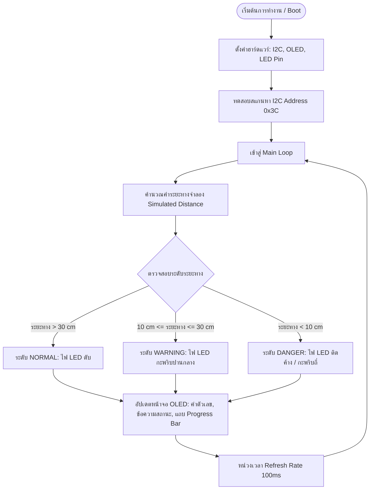

# โครงงานพัฒนาระบบวัดระยะทางด้วยเซนเซอร์จำลอง (Distance Measurement System)

เอกสารแนะนำการพัฒนาโครงงานระบบวัดระยะทางจำลองด้วยบอร์ด **Raspberry Pi Pico** แสดงผลผ่านหน้าจอ **OLED I2C** และส่งสัญญาณเตือนผ่าน **LED Lamp** โดยใช้การจำลองค่าเซนเซอร์ **Ultrasonic Sensor HC-SR04** ผ่านซอฟต์แวร์ MicroPython

---

## สารบัญ
1. [ภาพรวมของระบบ (System Overview)](#1-ภาพรวมของระบบ-system-overview)
2. [รายการอุปกรณ์ (Hardware Components)](#2-รายการอุปกรณ์-hardware-components)
3. [ผังการต่อวงจร (Wiring Diagram & Pinout)](#3-ผังการต่อวงจร-wiring-diagram--pinout)
4. [โครงสร้างระบบและการจำลองค่า (Simulation Concept & Logic)](#4-โครงสร้างระบบและการจำลองค่า-simulation-concept--logic)
5. [การเตรียมเครื่องมือและสภาพแวดล้อมการเขียนโปรแกรม](#5-การเตรียมเครื่องมือและสภาพแวดล้อมการเขียนโปรแกรม)
6. [โครงสร้างไฟล์ในโปรเจกต์ (Project Structure)](#6-โครงสร้างไฟล์ในโปรเจกต์-project-structure)
7. [การทำงานของโค้ดโปรแกรม (Source Code Details)](#7-การทำงานของโค้ดโปรแกรม-source-code-details)
8. [ขั้นตอนการทดสอบและผลลัพธ์ (Testing & Validation)](#8-ขั้นตอนการทดสอบและผลลัพธ์-testing--validation)
9. [การต่อยอดสู่เซนเซอร์จริง (Transition to Real Hardware)](#9-การต่อยอดสู่เซนเซอร์จริง-transition-to-real-hardware)

---

## 1. ภาพรวมของระบบ (System Overview)

ระบบนี้ถูกออกแบบมาเพื่อศึกษาและพัฒนาระบบฝังตัว (Embedded System / IoT) สำหรับตรวจวัดระยะห่างของวัตถุ โดยในแล็บนี้จะใช้ **การจำลองค่าสัญญาณ Ultrasonic Sensor (HC-SR04 Simulation)** เพื่อให้สามารถพัฒนาตรรกะการควบคุมและส่วนติดต่อผู้ใช้ (UI) บนหน้าจอ OLED ได้ทันทีโดยไม่ต้องพึ่งพาเซนเซอร์จริง

### ฟังก์ชันหลักของระบบ:
- **จำลองระยะทาง (Distance Simulation):** จำลองการเคลื่อนที่ของวัตถุเข้า-ออกระหว่างระยะ 2 cm ถึง 100 cm อย่างต่อเนื่องและสมจริง
- **แสดงผลข้อมูลบนหน้าจอ OLED (SSD1306):**
  - แสดงค่าระยะทางปัจจุบันในหน่วยเซนติเมตร (cm)
  - แสดงสถานะความปลอดภัย: `NORMAL` (ปลอดภัย), `WARNING` (เตือน), `DANGER!` (อันตราย/ใกล้เกินไป)
  - แสดงแถบกราฟิกวัดระดับระยะทาง (Progress / Distance Bar)
- **ระบบไฟเตือน LED Lamp:**
  - **ระยะไกล (> 30 cm):** ไฟ LED ดับ (สภาวะปกติ)
  - **ระยะปานกลาง (10 - 30 cm):** ไฟ LED กะพริบเป็นจังหวะเตือน
  - **ระยะใกล้ (< 10 cm):** ไฟ LED ติดค้าง หรือกะพริบถี่มาก เพื่อเตือนว่ามีวัตถุอยู่ใกล้เกินไป

---

## 2. รายการอุปกรณ์ (Hardware Components)

| ลำดับ | อุปกรณ์ | จำนวน | หน้าที่การทำงาน |
| :---: | :--- | :---: | :--- |
| 1 | **Raspberry Pi Pico / Pico 2** | 1 บอร์ด | ไมโครคอนโทรลเลอร์หลัก ประมวลผลคำนวณและขับแสดงผล |
| 2 | **OLED Display 0.96" I2C (SSD1306)** | 1 ชิ้น | หน้าจอแสดงผลแบบกราฟิกขาว-ดำ ความละเอียด 128x64 พิกเซล |
| 3 | **หลอด LED (LED Lamp)** | 1 หลอด | ใช้เป็นสัญญาณไฟเตือนระยะ (เช่น สีแดง หรือ สีเหลือง) |
| 4 | **ตัวต้านทาน 220Ω หรือ 330Ω** | 1 ตัว | จำกัดกระแสไฟฟ้าสำหรับหลอด LED เพื่อป้องกันบอร์ดและหลอดเสียหาย |
| 5 | **Ultrasonic Sensor HC-SR04** | - | *(จำลองผ่าน MicroPython Code ไม่จำเป็นต้องต่อจริง)* |
| 6 | **บอร์ดทดลอง (Breadboard) และสายไฟ Jumper** | 1 ชุด | สำหรับเชื่อมต่อวงจร |
| 7 | **สาย Micro-USB** | 1 เส้น | สำหรับเชื่อมต่อและจ่ายไฟจากคอมพิวเตอร์เข้าบอร์ด Pico |

---

## 3. ผังการต่อวงจร (Wiring Diagram & Pinout)

### 3.1 ตารางการเชื่อมต่อขา (Pin Assignment)

| อุปกรณ์ | ขาของอุปกรณ์ | ต่อเข้าขา Pico (Pin Name) | ขาจริงบนบอร์ด (Physical Pin) | หมายเหตุ |
| :--- | :--- | :--- | :--- | :--- |
| **OLED Display** | **VCC** | 3V3(OUT) | Pin 36 | ไฟเลี้ยงจอ 3.3V |
| | **GND** | GND | Pin 38 | กราวด์ระบบ |
| | **SDA** | **GP4** | Pin 6 | I2C0 SDA (ส่งข้อมูล) |
| | **SCL** | **GP5** | Pin 7 | I2C0 SCL (สัญญาณนาฬิกา) |
| **LED Lamp** | ขาบวก (Anode / ขายาว) | ผ่าน R 220Ω $\rightarrow$ **GP15** | Pin 20 | ควบคุมสัญญาณ Digital / PWM |
| | ขาลบ (Cathode / ขาสั้น) | **GND** | Pin 18 หรือ Pin 23 | กราวด์ |
| **HC-SR04 (จำลอง)** | - | *จำลองในซอฟต์แวร์* | - | รันผ่าน Class ภายในโค้ด |

```
                       Raspberry Pi Pico
                         +------------+
        (OLED SDA) GP4 --| 1       40 |-- VBUS (5V)
        (OLED SCL) GP5 --| 2       39 |-- VSYS
                   GND --| 3       38 |-- GND  -------- (OLED GND)
                         | ...     36 |-- 3V3(OUT) ---- (OLED VCC)
(LED Anode via R) GP15 --| 20      21 |-- ...
                   GND --| 23      18 |-- GND  -------- (LED Cathode)
                         +------------+
```

---

## 4. โครงสร้างระบบและการจำลองค่า (Simulation Concept & Logic)



### ตรรกะการจำลองเซนเซอร์ (Simulation Engine):
เซนเซอร์ HC-SR04 จะสร้างสัญญาณคลื่นอัลตราโซนิกความถี่ 40 kHz และวัดระยะเวลาสะท้อนกลับ ในโค้ดจำลองนี้เราใช้ฟังก์ชันทางคณิตศาสตร์ผสมการสุ่มแบบธรรมชาติ (Smooth Waveform + Gaussian Jitter) เพื่อจำลองวัตถุที่เคลื่อนเข้ามาใกล้และถอยห่างออกไป:
$$\text{Distance}(t) = 50 + 45 \times \sin(\omega t) + \text{Noise}$$
- จะได้ค่าระยะทางแกว่งตัวอย่างนุ่มนวลระหว่าง **5 cm ถึง 95 cm**
- เสมือนมีวัตถุกำลังเคลื่อนที่เข้าใกล้และออกห่างจากเซนเซอร์ตลอดเวลา ช่วยให้ทดสอบการตอบสนองของจอและไฟเตือนได้ครบทุกย่าน

---

## 5. การเตรียมเครื่องมือและสภาพแวดล้อมการเขียนโปรแกรม

### ทางเลือกที่ 1: การใช้งานผ่าน VS Code ด้วยส่วนขยาย MicroPico (แนะนำ)
1. ติดตั้ง **Visual Studio Code**
2. ไปที่แถบ **Extensions (`Ctrl + Shift + X`)** ค้นหาและติดตั้งส่วนขยาย **`MicroPico`** (โดย paulober)
3. เสียบสาย USB เชื่อมต่อ Raspberry Pi Pico กับคอมพิวเตอร์
4. ดูที่แถบ Status Bar ด้านล่าง หากขึ้น `Pico Disconnected` ให้คลิกเพื่อเชื่อมต่อ หรือกด `Ctrl + Shift + P` เลือก **`MicroPico: Connect`**

### ทางเลือกที่ 2: การใช้งานผ่าน Thonny IDE
1. ติดตั้งโปรแกรม **Thonny IDE** จาก [thonny.org](https://thonny.org/)
2. ตั้งค่าล่าม: `Tools` $\rightarrow$ `Options...` $\rightarrow$ `Interpreter` เลือก **MicroPython (Raspberry Pi Pico)** และเลือกพอร์ต COM ให้ถูกต้อง

---

## 6. โครงสร้างไฟล์ในโปรเจกต์ (Project Structure)

ภายในโฟลเดอร์โครงงานประกอบด้วยไฟล์สำคัญดังนี้:

```text
week06-Pico2-Multisensor/
├── README.md           # เอกสารคู่มือการพัฒนาและรายละเอียดวงจร (ไฟล์นี้)
├── ssd1306.py          # ไลบรารี Driver หน้าจอ OLED I2C สำหรับ MicroPython
└── main.py             # โค้ดหลักในการจำลองเซนเซอร์ ควบคุมไฟ LED และขับจอ OLED
```

---

## 7. การทำงานของโค้ดโปรแกรม (Source Code Details)

### 7.1 ไฟล์ไลบรารี `ssd1306.py`
ใช้ไดรเวอร์มาตรฐานของ MicroPython สำหรับชิป SSD1306 ซึ่งรองรับการวาดเส้น, ข้อความ (Font 8x8), สี่เหลี่ยม, และการจัดการ Framebuffer

### 7.2 ตัวอย่างโค้ดหลัก `main.py`
โปรแกรมแบ่งการทำงานออกเป็น 3 โมดูลชัดเจน:
1. **`DistanceSensorSimulator`**: คลาสจำลองการอ่านค่าอัลตราโซนิก
2. **`DisplayManager`**: คลาสจัดการแสดงผลบนหน้าจอ OLED มีฟังก์ชันวาด Progress Bar
3. **`AlertManager`**: คลาสควบคุมไฟ LED ตามเงื่อนไขความปลอดภัย

*(ดูซอร์สโค้ดฉบับเต็มได้ในไฟล์ [main.py](file:///c:/Users/USER/Documents/IoT%20Programming%20and%20Development/week06-Pico2-Multisensor/main.py))*

---

## 8. ขั้นตอนการทดสอบและผลลัพธ์ (Testing & Validation)

### 8.1 การอัปโหลดและทดสอบผ่าน VS Code (MicroPico)

1. **ตรวจสอบการเชื่อมต่อ (Connect):**
   - เสียบสาย USB เข้ากับ Pico
   - สังเกตแถบ **Status Bar ด้านล่างของ VS Code** จะมีสถานะ `Pico Connected`
   - หากยังไม่เชื่อมต่อ ให้กด `Ctrl + Shift + P` แล้วเลือก `MicroPico: Connect`

2. **อัปโหลดไฟล์เข้าบอร์ด Pico (Upload to Pico):**
   - **วิธีที่ 1 (อัปโหลดทั้งโฟลเดอร์):** กดปุ่ม `Ctrl + Shift + P` พิมพ์คำว่า **`MicroPico: Upload project to Pico`** หรือคลิกไอคอนรูปลูกศรชี้ขึ้น (Upload) ที่ Status Bar ด้านล่าง
   - **วิธีที่ 2 (อัปโหลดทีละไฟล์):** 
     - คลิกขวาที่ไฟล์ `ssd1306.py` $\rightarrow$ เลือก **`Upload file to Pico`**
     - คลิกขวาที่ไฟล์ `main.py` $\rightarrow$ เลือก **`Upload file to Pico`**

3. **สั่งรันโปรแกรม (Run on Pico):**
   - เปิดไฟล์ `main.py`
   - คลิกปุ่ม **Run** (รูปปุ่ม Play ▶) ที่ Status Bar ด้านล่าง หรือกด `Ctrl + Shift + P` แล้วเลือก **`MicroPico: Run current file on Pico`**
   - เปิดหน้าต่าง Terminal ขึ้นมาดูผลลัพธ์ผ่าน **MicroPico REPL**

> [!TIP]
> **การทำงานอัตโนมัติ (Auto-run on Boot):**
> เนื่องจากไฟล์หลักตั้งชื่อว่า `main.py` เมื่ออัปโหลดไฟล์เข้าบอร์ด Pico ผ่านคำสั่ง `Upload project to Pico` แล้ว ไม่ว่าจะถอดสาย USB แล้วเสียบใหม่ หรือจ่ายไฟจาก Power Bank บอร์ด Pico จะบูตและรันโปรแกรมระบบวัดระยะนี้ทันทีโดยไม่ต้องเปิดคอมพิวเตอร์!

### 8.2 การทดสอบผ่าน Thonny IDE (ทางเลือกสำรอง)
1. เปิดโปรแกรม Thonny IDE
2. บันทึกไฟล์ `ssd1306.py` และ `main.py` ลงในบอร์ด Raspberry Pi Pico
3. กดปุ่ม **Run Current Script (F5)**

### 8.3 ผลลัพธ์ที่สังเกตได้
- **Terminal / REPL Console:** พิมพ์ค่าระยะทางและสถานะออกมาอย่างต่อเนื่อง เช่น:
  ```text
  [STATUS] ระยะทาง:  18.4 cm | โซน: WARNING  | LED: BLINK
  [STATUS] ระยะทาง:   8.2 cm | โซน: DANGER!  | LED: BLINK
  [STATUS] ระยะทาง:  45.0 cm | โซน: SAFE     | LED: OFF
  ```
- **OLED Display:**
  - บรรทัดบน: แสดง `DIST MON [SIM]`
  - กลางจอ: แสดงระยะทาง เช่น `Dist: 18.4 cm` และ `Zone: WARNING`
  - ล่างจอ: มีแถบ Progress Bar ยืด-หดแบบเรียลไทม์ตามระยะทาง
- **LED Lamp:** กะพริบช้า (เมื่ออยู่ในโซนเตือน) หรือกะพริบเร็วถี่มาก (เมื่อเข้าใกล้เกินไปในโซนอันตราย)

---

## 9. การต่อยอดสู่เซนเซอร์จริง (Transition to Real Hardware)

เมื่อต้องการเปลี่ยนจากการจำลองมาใช้ฮาร์ดแวร์ **HC-SR04** ของจริง:

> [!WARNING]
> **ข้อควรระวังเรื่องแรงดันไฟฟ้า (Voltage Warning):**
> ขา **Echo** ของเซนเซอร์ HC-SR04 ส่งสัญญาณ 5V ออกมา ขณะที่ขา GPIO ของ Raspberry Pi Pico รองรับแรงดันได้สูงสุด **3.3V** เท่านั้น **ห้ามต่อ Echo เข้า Pico โดยตรง** ต้องใช้วงจรแบ่งแรงดัน (Voltage Divider) ด้วยตัวต้านทาน (เช่น $1\text{ k}\Omega$ และ $2\text{ k}\Omega$) เพื่อลดทอนแรงดันลงเหลือประมาณ 3.3V ก่อนเข้าขา GPIO!

### ตารางการต่อขา HC-SR04 จริง:
- **VCC:** ต่อไฟ 5V (ขา 40 VBUS ของ Pico)
- **GND:** ต่อ GND (ขา 38)
- **Trig:** ต่อเข้า GP2 (Pin 4)
- **Echo:** ต่อผ่าน Voltage Divider เข้า GP3 (Pin 5)

สามารถสลับการทำงานในโค้ด `main.py` โดยเปลี่ยนค่าตัวแปร `USE_SIMULATION = False` ระบบจะเปลี่ยนไปอ่านสัญญาณ Pulse จากเซนเซอร์จริงได้ทันที
